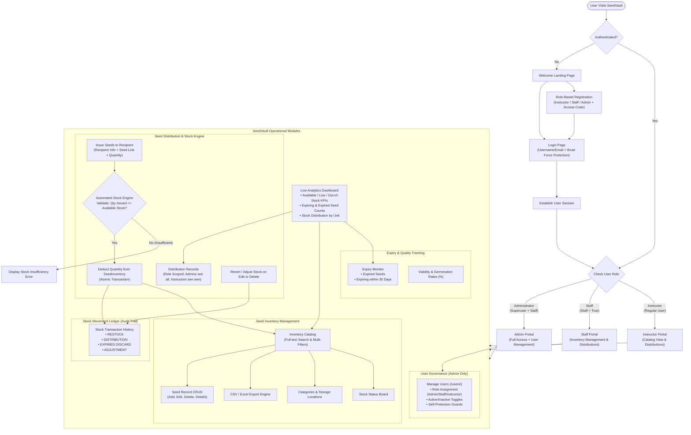
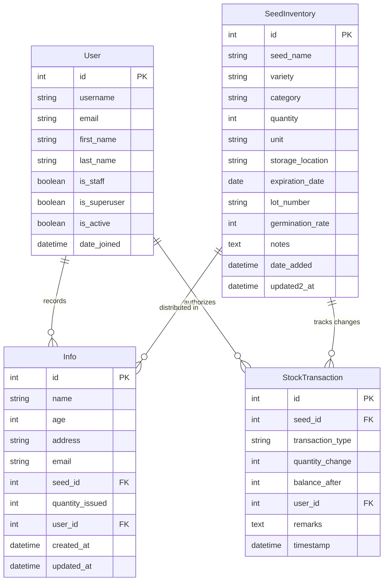

# SeedVault: Comprehensive System Master Plan
**Seed Inventory Tracking System — BSIT-3B**

---

## 1. Overall System Architecture & Workflow

The following flowchart outlines the end-to-end user journeys, role boundaries, core operational modules, and the automated stock deduction engine in SeedVault:

---

## 2. System Scope & Objectives

**SeedVault** is an institutional seed repository tracking 20application tailored for agricultural education, gene banks, and institutional research farms.

### Core Objectives:
1. **Accurate Stock Tracking**: Guarantee real-time stock balances across all units (packets, grams, kilograms, pieces).
2. **Automated Inventory-Distribution Synchronization**: Prevent negative inventory and automatically deduct issued quantities upon distribution.
3. **Loss Prevention & Viability Monitoring**: Proactively flag seeds nearing expiration ($30$-day window) and expired seeds to maintain high germination rates.
4. **Role-Based Access Control (RBAC)**: Ensure strict segregation of duties between Administrators, Staff, and Instructors.
5. **Auditable Movement Ledger**: Maintain an immutable transaction history of all inbound, outbound, and adjustment events.

---
221
## 3. Role-Based Access Control (RBAC) Matrix

| Feature / Action | Instructor | Staff | Administrator |
| :--- | :---: | :---: | :---: |
| **View Dashboard & KPIs** | Yes | Yes | Yes |
| **Browse Seed Catalog & Search** | Yes | Yes | Yes |
| **Filter by Category / Location / Status** | Yes | Yes | Yes |
| **Export Inventory (CSV/Excel)** | Yes | Yes | Yes |
| **Add New Seed Record** | View/Request | Yes | Yes |
| **Edit Seed Record** | No | Yes | Yes |
| **Delete Seed Record** | No | No | Yes |
| **Log Seed Distribution** | Yes (Self-scoped) | Yes (Global) | Yes (Global) |
| **Edit/Delete Own Distributions** | Yes | Yes | Yes |
| **View All Distribution Logs** | No (Own only) | Yes | Yes |
| **Stock Movement Ledger (Audit)** | View Only | View / Log | Full Access |
| **Manage Users (`/users/`)** | Denied | Denied | Full Access |
| **Assign Roles & Deactivate Accounts** | Denied | Denied | Full Access |

---

## 4. Comprehensive Master Task Checklist

### Phase 1: Core Integrity, Critical Fixes & Test Suite
- [x] **Database Portability & Test Environment**:
  - [x] Configure dynamic SQLite fallback in `mysite/settings.py` for automated test execution without requiring an active MySQL daemon.
  - [x] Keep production/development MySQL (`bsit3b_seedvault`) intact.
- [x] **Role-Based User Management Upgrade**:
  - [x] Upgrade `apps/users/views.py` to handle explicit roles (`administrator`, `staff`, `instructor`).
  - [x] Add self-demotion and self-deactivation protection for administrators.
  - [x] Re-enable the "Add User" button in `templates/users/list.html`.
  - [x] Replace the switch with a formal Role `<select>` dropdown.
  - [x] Add automated test suite with 7 test cases in `apps/users/tests.py` (100% passing).
- [x] **Admin Scoping Fix**:
  - [x] Update `apps/scoping.py` so Administrators and Staff can view and manage all distributions across the institution, while Instructors see their own records.
- [ ] **Stock Deduction Engine (`apps.info`)**:
  - [ ] Wrap `info_save_ajax` in an atomic transaction (`transaction.atomic`).
  - [ ] Validate `quantity_issued <= seed.quantity`; reject with error if insufficient.
  - [ ] Deduct issued quantity from `SeedInventory.quantity` on new distribution.
  - [ ] Handle edits: adjust stock delta when quantity or seed is altered.
  - [ ] Handle deletes (`info_delete_ajax`): restore deducted stock back to `SeedInventory`.
  - [ ] Fix modal error display in `templates/info.html` to target `#infoFormError` inside modal body.
  - [ ] Write automated test suite in `apps/info/tests.py`.

---

### Phase 2: Agricultural Domain Features & Batch Tracking
*(See full guide: [`SEED_VARIANTS.md`](./SEED_VARIANTS.md))*
- [ ] **Seed Variety & Variant Strategy**:
  - [ ] Implement autocomplete / datalist on `seed_name` in seed form to standardize crop names while supporting freeform varieties.
  - [ ] Evaluate two-tier (`Crop` -> `SeedVariety` -> `SeedBatch`) migration roadmap.
- [ ] **Batch & Lot Model / Schema Extension**:
  - [ ] Add `lot_number` (CharField, e.g. `LOT-2026-RICE-01`) to track distinct harvest batches.
  - [ ] Add `germination_rate` (PositiveIntegerField, $0-100\%$) to track viability.
  - [ ] Add `purity_percentage` (DecimalField, $0-100\%$).
  - [ ] Add `harvest_date` (DateField) and `supplier_source` (DA, PhilRice, IRRI, Kaneko, etc.).
- [ ] **Batch-Specific Expiry & Retest Scheduling**:
  - [ ] Schedule viability retest alerts ($6$ or $12$ months depending on species).
  - [ ] Add viability status badge (*High Viability*, *Retest Required*, *Low Viability*).
- [ ] **Philippine Agricultural Seeder Expansion**:
  - [ ] Enhance `python manage.py seed_demo` with lot numbers and germination test records.

---

### Phase 3: Stock Movement Ledger (Audit Trail)
- [ ] **`StockTransaction` Model**:
  - [ ] Fields: `seed` (FK), `transaction_type` (`RESTOCK`, `DISTRIBUTION`, `EXPIRED_DISCARD`, `ADJUSTMENT`, `RETURN`), `quantity_change` (Integer +/-), `balance_after` (PositiveInteger), `user` (FK), `remarks` (TextField), `timestamp` (auto_now_add).
- [ ] **Automatic Ledger Recording**:
  - [ ] Log entry on seed creation / initial inventory.
  - [ ] Log entry on seed restocking / quantity edit.
  - [ ] Log entry on distribution issuance or deletion.
  - [ ] Log entry when expired seeds are culled/discarded.
- [ ] **Audit Trail UI Page**:
  - [ ] Dedicated searchable history table with filter by date range, transaction type, seed, and user.
  - [ ] CSV export of stock ledger for inventory audits.

---

### Phase 4: Role-Based Workflow & Governance
- [ ] **Enforce Granular Permissions on Seed Inventory**:
  - [ ] Protect `inventory_create`, `inventory_edit`, and `inventory_delete` in `apps/core/views.py`:
    - Only `Staff` and `Administrator` can create or edit seed inventory.
    - Only `Administrator` can delete seed inventory items.
    - Instructors have view-only catalog access with a "Request Seed" requisition button.
- [ ] **Requisition / Approval Workflow (Optional Advance Feature)**:
  - [ ] Instructor submits requisition $\rightarrow$ Status: `Pending`.
  - [ ] Staff/Admin approves and issues $\rightarrow$ Deducts stock and creates distribution record.

---

### Phase 5: Visual Analytics, Alerts & Label Automation
- [ ] **ApexCharts Interactive Dashboard**:
  - [ ] Stock distribution by category (Donut Chart).
  - [ ] Monthly seed distribution timeline (Area / Spline Chart).
  - [ ] Storage location capacity utilization (Bar Chart).
- [ ] **Low Stock & Expiration In-App Alerts**:
  - [ ] Header notification bell dropdown showing real-time low-stock and expiring batches.
- [ ] **Printable Seed Labels & QR Codes**:
  - [ ] Generate printable seed packet/jar labels with QR code containing:
    - Seed Name & Variety
    - Lot Number & Category
    - Date Stored & Expiration Date
    - Storage Location Bin / Shelf
  - [ ] Fast search via QR code scan.

---

### Phase 6: Code Quality, Documentation & Deployment
- [ ] Complete unit and integration test coverage across `apps.core`, `apps.users`, and `apps.info`.
- [ ] Refactor legacy table names (e.g., migrate `tblinfo` to `seed_distributions`).
- [ ] Clean up deprecated files and artifacts (`preview.sqlite3`, legacy tables).
- [ ] Configure environment variables via `.env` (`SECRET_KEY`, `DEBUG`, `DATABASE_URL`, `SEEDVAULT_ADMIN_CODE`).
- [ ] Deployment guide for production (Gunicorn, Nginx, MariaDB/MySQL).

---

## 5. Entity Rela2tionship (ER) Diagram

---

*This document is the official blueprint and master checklist for the SeedVault project. Keep tasks updated as features are delivered.*

