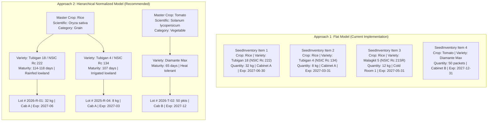

# Seed Variety & Variant Storage Architecture
**SeedVault — Seed Inventory Tracking System (BSIT-3B)**

---

## 1. Overview & Agricultural Context

In agricultural gene banks, university research facilities, and community seed vaults, seeds of the same crop (e.g., Rice, Tomato, Corn) possess numerous **varieties / cultivars / variants**. Each variant differs in:
- Days to maturity (early, medium, late maturing).
- Environmental resilience (drought, flood/submergence, saline, pest resistance).
- Viability duration and storage requirements.
- Physical batch lots (harvest dates and germination rates).

This document details:
1. **How SeedVault stores variants currently (Flat Architecture)**.
2. **The Two-Tier / Three-Tier Hierarchical Upgrade (Normalized Architecture)**.
3. **Data entry patterns, UI workflows, and database queries for variants**.

---

## 2. Architecture Comparison



---

## 3. Approach 1: Flat Model (Currently in Production)

### Database Schema in `apps/core/models.py`
In this approach, each record represents one physical stock of a specific variant:

```python
class SeedInventory(models.Model):
    seed_name = models.CharField(max_length=150)           # Master Crop (e.g., "Rice", "Corn", "Tomato")
    variety = models.CharField(max_length=150, blank=True) # Variant / Cultivar (e.g., "NSIC Rc 222", "Cherry")
    category = models.CharField(max_length=20, choices=CATEGORY_CHOICES, default="other")
    quantity = models.PositiveIntegerField(default=0)
    unit = models.CharField(max_length=20, choices=UNIT_CHOICES, default="packets")
    storage_location = models.CharField(max_length=150, blank=True)
    expiration_date = models.DateField(null=True, blank=True)
    notes = models.TextField(blank=True)
    date_added = models.DateTimeField(auto_now_add=True)
    updated_at = models.DateTimeField(auto_now=True)

    def __str__(self):
        return f"{self.seed_name} - {self.variety}" if self.variety else self.seed_name
```

### Real-World Data Example from System Seeder:
```python
# Multiple varieties of Rice co-existing as distinct inventory entries:
SeedInventory.objects.create(
    seed_name="Rice",
    variety="Tubigan 18 / NSIC Rc 222",
    category="grain",
    quantity=32,
    unit="kilograms",
    storage_location="Seed Vault - Cabinet A",
    expiration_date="2027-06-30"
)

SeedInventory.objects.create(
    seed_name="Rice",
    variety="Tubigan 4 / NSIC Rc 134",
    category="grain",
    quantity=8,
    unit="kilograms",
    storage_location="Seed Vault - Cabinet A",
    expiration_date="2027-03-31"
)

SeedInventory.objects.create(
    seed_name="Rice",
    variety="Malagkit 5 / NSIC Rc 21SR",
    category="grain",
    quantity=12,
    unit="kilograms",
    storage_location="Cold Room - Shelf 1",
    expiration_date="2027-05-31"
)
```

### Advantages & Limitations of the Flat Model:
- **Pros**:
  - Simple schema, zero extra tables or migrations needed right now.
  - Quick to add new items via the current form (`/inventory/add/`).
  - Search matches both `seed_name` and `variety` simultaneously.
- **Cons**:
  - Potential typographical inconsistencies (e.g., user enters `"Rice"` on one record and `"rice"` or `"Palay"` on another).
  - Difficult to store shared botanical data (e.g. scientific name, optimal germination temperature) without duplicating it on every variant.

---

## 4. Approach 2: Hierarchical Normalized Model (Recommended Upgrade)

To scale SeedVault to standard gene bank specifications, normalize the schema into a **3-tier hierarchy**:

### 1. `Crop` (Master Species)
Represents the general botanical species:
```python
class Crop(models.Model):
    name = models.CharField(max_length=100, unique=True) # e.g. "Rice", "Tomato", "Eggplant"
    scientific_name = models.CharField(max_length=150, blank=True) # e.g. "Oryza sativa"
    category = models.CharField(max_length=20, choices=CATEGORY_CHOICES)
    description = models.TextField(blank=True)
```

### 2. `SeedVariety` (Cultivar / Variant)
Represents the genetic variety under that crop:
```python
class SeedVariety(models.Model):
    crop = models.ForeignKey(Crop, on_delete=models.CASCADE, related_name="varieties")
    variety_name = models.CharField(max_length=150) # e.g. "Tubigan 18", "Diamante Max"
    breeder_source = models.CharField(max_length=150, blank=True) # PhilRice, IRRI, Kaneko
    days_to_maturity = models.CharField(max_length=100, blank=True) # "114-118 days"
    characteristics = models.TextField(blank=True) # "Rainfed lowland, high milling recovery"

    class Meta:
        unique_together = ("crop", "variety_name")
```

### 3. `SeedBatch` / `InventoryItem` (Physical Storage & Stock)
Represents a specific harvest lot and physical storage container:
```python
class SeedBatch(models.Model):
    variety = models.ForeignKey(SeedVariety, on_delete=models.CASCADE, related_name="batches")
    lot_number = models.CharField(max_length=50, unique=True) # e.g. "LOT-2026-RICE-222"
    quantity = models.PositiveIntegerField(default=0)
    unit = models.CharField(max_length=20, choices=UNIT_CHOICES, default="kilograms")
    storage_location = models.CharField(max_length=150) # "Seed Vault - Cabinet A"
    harvest_date = models.DateField(null=True, blank=True)
    expiration_date = models.DateField(null=True, blank=True)
    germination_rate = models.PositiveIntegerField(null=True, blank=True) # e.g. 88%
```

---

## 5. User Interface Form Workflow Comparison

### Pattern A: Form Datalist / Autocomplete (Immediate Flat Enhancement)
Without altering the existing database tables, the `seed_name` input can be equipped with a HTML `<datalist>`:
```html
<label class="form-label required">Crop Name</label>
<input list="crop-list" name="seed_name" class="form-control" placeholder="Select or type crop name...">
<datalist id="crop-list">
    <option value="Rice">
    <option value="Corn">
    <option value="Tomato">
    <option value="Yardlong Bean (Sitao)">
    <option value="Eggplant">
</datalist>

<label class="form-label">Variety / Variant</label>
<input type="text" name="variety" class="form-control" placeholder="e.g. NSIC Rc 222 or Diamante Max">
```
*Benefit: Standardizes crop names instantly while allowing free typing for any new variant.*

---

### Pattern B: Dependent Dropdowns (Hierarchical)
For the normalized model:
1. User selects **Crop**: `[ Rice ▼ ]`
2. An AJAX endpoint populates the **Variety** dropdown:
   - `[ Tubigan 18 / NSIC Rc 222 ]`
   - `[ Tubigan 4 / NSIC Rc 134 ]`
   - `[ Malagkit 5 / NSIC Rc 21SR ]`
   - `[ + Add New Variety ]`
3. User enters storage container details (Lot #, Quantity, Unit, Location, Expiration).

---

## 6. Common Reporting & Aggregation Queries

### Query 1: Total Stock of a Crop across ALL Varieties
```python
# Sum all quantities of Rice regardless of variety
from django.db.models import Sum

total_rice = SeedInventory.objects.filter(
    seed_name__iexact="Rice"
).aggregate(total=Sum("quantity"))["total"] or 0
```

### Query 2: Breakdown of Variants for a Given Crop
```python
# List each variant of Rice with its stock level and storage location
rice_variants = SeedInventory.objects.filter(
    seed_name__iexact="Rice"
).values("variety", "quantity", "unit", "storage_location", "expiration_date")
```

### Query 3: Varieties with Zero or Low Stock
```python
# Flag depleted variants requiring replenishment
depleted_variants = SeedInventory.objects.filter(quantity=0).order_by("seed_name", "variety")
```

---

## 7. Migration Roadmap

If migrating from the Flat Model to the Normalized Model in the future:
1. Create `Crop` and `SeedVariety` models with migrations.
2. Run a data migration script that extracts unique `seed_name` records into `Crop`, and `(seed_name, variety)` pairs into `SeedVariety`.
3. Link the existing `SeedInventory` rows to their respective `SeedVariety` foreign keys.
4. Update forms and templates to utilize the parent-child selector.

